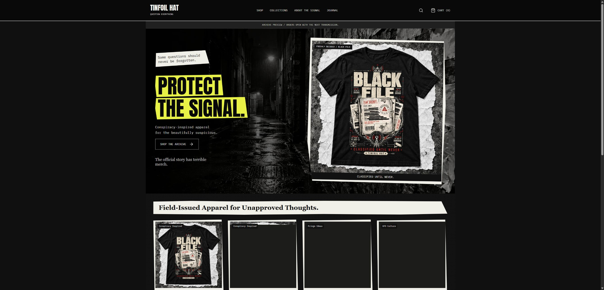

# Tinfoil Hat / The Photocopied Gospel

[Storefront preview](https://tinfoilhat.netlify.app) | [Source](https://github.com/effittdan/tinfoil-design)

The main storefront lives in `src/`, with Vite publishing `dist/` to Netlify. The old storefront is preserved in Git under the tag `archive-before-gospel-2026-10-12`. Raw references, print masters, and exploration boards stay outside the publish folder.

## Local work

`npm install`, `npm run dev`, `npm test`, `npm run build`.

Routes: homepage, shop, collections, 25 product pages, cart, checkout, order status, about/manifesto, journal and four lore articles, shipping, contact, privacy, terms, and 404. The cart persists in the browser. Size selection is required; original artwork is available beside illustrative garment photographs. Newsletter and contact forms use Netlify Forms.

The new catalog is a preview until it is mapped to real Printful products. Preview prices, garment types, colors and sizes are design proposals. Generated product photography must be checked against real Printful templates/samples before commerce opens. The original transparent artwork is unchanged; optimized display derivatives are in `public/assets/artwork`.

## Connections and launch

See [docs/COMMERCE-SETUP.md](docs/COMMERCE-SETUP.md). Printful product lookup, shipping estimates, Stripe Checkout, PayPal Orders/capture, signature-verified payment webhooks, private PostgreSQL order storage and deduplicated Printful draft creation are implemented server-side. A dedicated restricted Stripe test key and test webhook are configured privately in Netlify. End-to-end merchant payment/fulfillment tests are pending Printful mappings, PayPal developer access and order storage. Orders are created as drafts in Printful for merchant review; automatic fulfillment spending is not enabled.

Never put credentials in `src`, public assets, catalog JSON, GitHub, or screenshots. Use Netlify environment variables scoped to Functions and local ignored `.env` for development. `COMMERCE_ENABLED=false` is the default. Do not enable it before merchant policies, product mappings, tax setup, webhooks, storage and sandbox purchases have passed review.

## Content and operations

Brand copy lives in `src/content.js`; editable product metadata in `data/catalog.json`; reviewed Printful sync-product IDs in `data/fulfillment.json`. The catalog importer performs read-only discovery and never guesses matches. Review and map each new design to the correct real Printful product; the old WooCommerce catalog contains different artwork.

Shipments are quoted by Printful, and Stripe Tax calculates tax for both payment providers. The order quote is stored for 20 minutes. Payment redirects alone do not prove payment. Webhook/capture verification compares paid currency, amount and order identity. Stable provider request IDs, database row locks and Printful external IDs prevent duplicate fulfillment drafts. Paid orders whose draft creation fails can be retried by webhook redelivery; inspect `error_code` and `fulfillment_state` in private order storage.

Deploy previews should use sandbox keys and a separate test database. Production commerce must use live provider keys/webhook IDs, real catalog variants, merchant-approved policies and delivery countries. No WordPress settings, DNS records or existing Printful products were changed by the rebuild. The preview does not replace the existing tinfoildesign.com domain yet.
